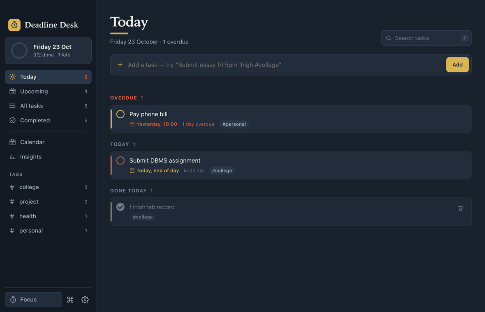
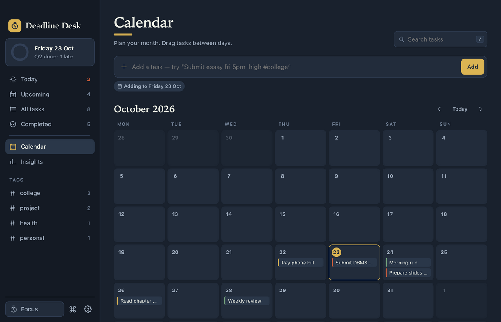
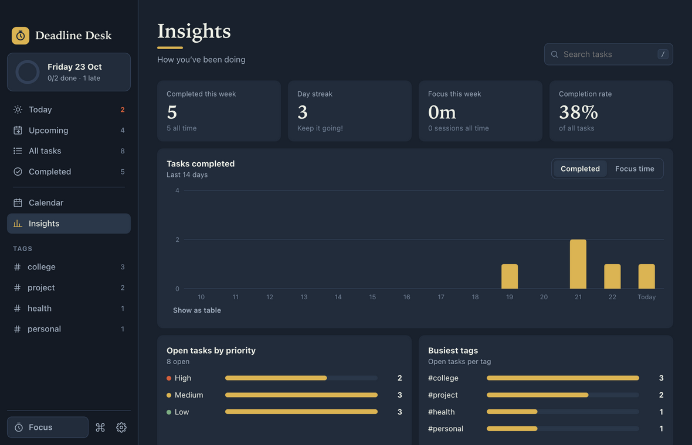
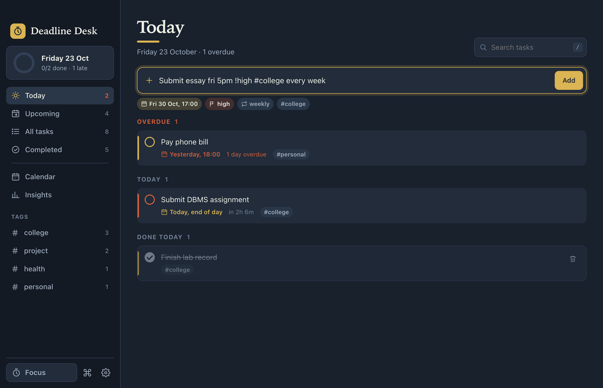
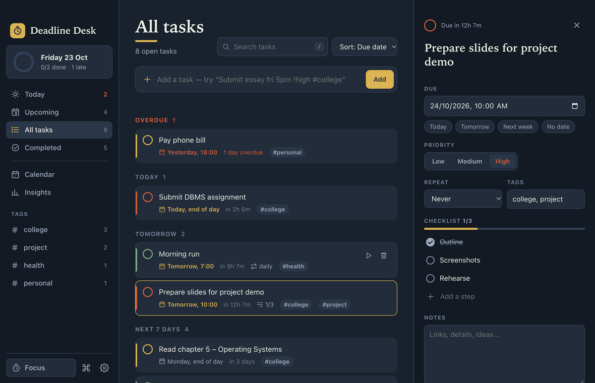
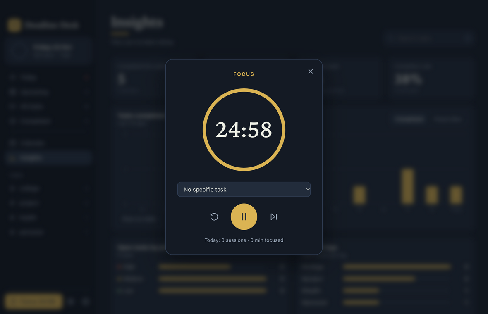
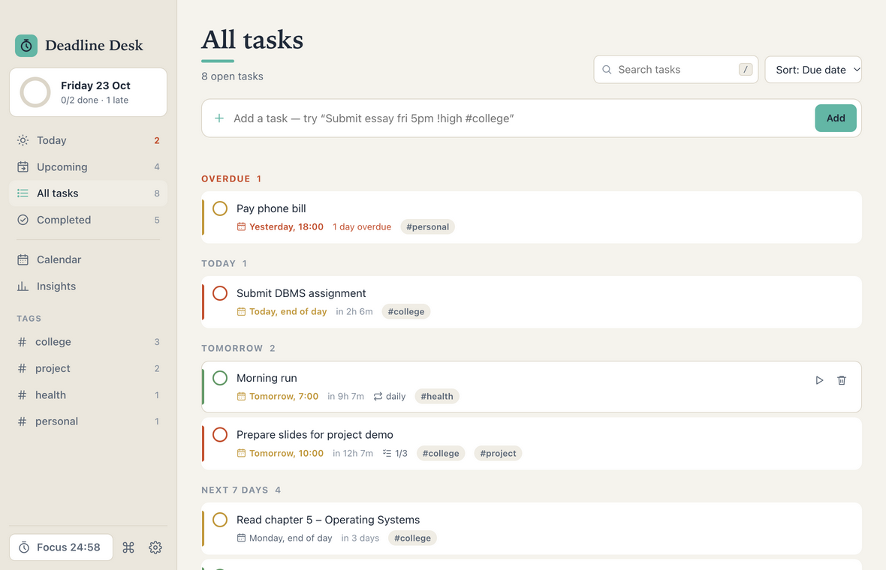

# Watcher

A desktop deadline planner built with Electron. Type tasks in plain English ("Submit essay fri 5pm !high #college"), get native reminders before they're due, plan your month on a drag-and-drop calendar, work through tasks with a built-in focus timer, and see your progress on an insights dashboard.



## Features

### Planning
- **Natural-language quick add.** Type `Lab report next wed 5pm !high #college every week` and the date, time, priority, tag and repeat rule are picked out, with a live preview as you type.
- **Smart views.** Today (with overdue), Upcoming (the next seven days, day by day), All tasks (grouped by deadline), Completed, and one view per tag.
- **Task details panel.** Edit the title, deadline, priority, tags and repeat rule, add a checklist of steps with a progress bar, and keep notes.
- **Recurring tasks.** Daily, every weekday, weekly or monthly. Completing one schedules the next occurrence.
- **Live countdowns.** Every task shows "in 2h 13m" or "1 day overdue", updated in real time.
- **Search and sort.** Search titles, notes and tags with matches highlighted. Sort by due date, priority, newest or A–Z.
- **Undo.** Deleting, completing or clearing tasks can be undone from the toast.

### Calendar
- Month grid with each task shown on its due day, colour-coded by priority.
- **Drag a task to another day** to reschedule it (the time is kept).
- Click a day to see its tasks. Quick add then adds to that day.



### Focus timer (Pomodoro)
- Configurable focus and break lengths, linked to a task.
- Keeps running in the background. The countdown shows in the sidebar, the window title and the macOS menu bar.
- Notifies you when a session ends, and logs the minutes against the task.

### Insights
- Completed this week, day streak, focus time, completion rate and on-time rate.
- 14-day bar chart of completed tasks or focus minutes, with hover tooltips and a table view.
- Open tasks by priority and the busiest tags.



### Desktop integration (Electron)
| Feature | How it works |
|---|---|
| Native notifications | Reminders a configurable time before each deadline (5 min to 1 day), and when it's reached. Clicking one opens the task. |
| System tray / menu bar | Shows today's count (or the focus countdown), the next five deadlines, Quick Add and Start Focus. |
| Global shortcut | **⌘⇧D / Ctrl+Shift+D** brings the app forward with quick add focused, from any app. |
| Dock badge | Number of tasks due today plus overdue. |
| Native menus | File / Edit / View / Window / Help with keyboard accelerators. |
| Native dialogs | Save and open dialogs for export and import; a confirmation dialog before erasing data. |
| File storage | Tasks are saved as JSON in the user-data folder, written atomically (temp file and rename) so a crash can't corrupt them. |
| Window state | Size and position are remembered between launches. |
| Single instance | Opening the app again focuses the existing window. |
| Installers | `npm run dist` builds a .dmg (macOS), .exe installer (Windows) or AppImage (Linux). |

### Personalisation
- Dark, light or system theme, and five accent colours.
- Command palette (**⌘K**) to search tasks and run any command.
- Keyboard shortcuts for everything (press **?** in the app).
- A confetti celebration when you clear everything due today (can be turned off).
- Export to JSON (a full backup) or CSV (opens in Excel or Sheets), and import a backup.

<p>
  
  
  
  
</p>

## Keyboard shortcuts

| Keys | Action |
|---|---|
| `N` | New task |
| `⌘⇧D` / `Ctrl+Shift+D` | Quick add from anywhere (global) |
| `⌘K` | Command palette |
| `/` | Search |
| `⌘1` – `⌘6` | Today, Upcoming, All, Completed, Calendar, Insights |
| `F` | Focus timer (`Space` to start or pause) |
| `⌘,` | Settings |
| `⌘E` | Export backup |
| `?` | Show all shortcuts |
| `Esc` | Close the panel or dialog |

## Quick-add language

| Type | Meaning |
|---|---|
| `today`, `tonight`, `tomorrow`, `fri`, `next mon`, `dec 12`, `12 march`, `in 3 days`, `in 2h`, `in 45 min` | Due date |
| `5pm`, `5:30pm`, `17:00`, `at noon` | Due time (a date with no time means end of day) |
| `!high` `!med` `!low` (or `!1` `!2` `!3`) | Priority |
| `#college` | Tag (as many as you like) |
| `daily`, `every weekday`, `weekly`, `every monday`, `monthly` | Repeat |

## Tech stack
- **Electron 45.** Main process, preload bridge and renderer.
- **React 19** for the interface, built with **Vite**. Plain CSS with variables for theming; no UI library.
- **Node's built-in test runner** for unit tests.
- **electron-builder** for installers.

## Architecture & security

```
main.js              Main process: window, menus, tray, global shortcut, notifications, dialogs, file storage
preload.js           Exposes a small, explicit `window.desk` API to the page via contextBridge
vite.config.mjs      Builds the React app from src/ into build/ and adds the Content-Security-Policy
scripts/dev.mjs      `npm run dev`: Vite dev server + Electron with hot reload
src/
  index.html         Page shell and SVG icon set
  main.jsx           Loads saved data, starts the focus timer, renders <App />
  App.jsx            UI state, views, keyboard shortcuts, reminders, menu/tray commands
  styles.css         Theming (dark/light, accents) and component styles
  components/
    Sidebar.jsx        Views, tags, today progress ring, focus pill
    QuickAdd.jsx       Natural-language input with live preview
    TaskList.jsx       Grouped task list and task rows
    TaskDrawer.jsx     Task details: deadline, priority, repeat, tags, checklist, notes
    CalendarView.jsx   Month grid with drag-and-drop rescheduling
    StatsView.jsx      Insights tiles and SVG bar chart
    FocusModal.jsx     Pomodoro timer dialog
    SettingsModal.jsx  Appearance, reminders, timer and data settings
    CommandPalette.jsx ⌘K search across tasks and commands
    ShortcutsModal.jsx Keyboard and quick-add reference
    common.jsx         Icon, Highlight, Modal and Toasts
  lib/                 Framework-free logic, unit-tested in Node
    store.js           State, persistence, recurrence, import/export, migration from v1
    parser.js          Natural-language quick-add parser
    dates.js           Date formatting and countdowns
    views.js           Which tasks each view shows, grouping and sorting
    focus.js           Focus timer engine (keeps running when the dialog is closed)
    toast.js           Toast queue
    hooks.js           useStore / useFocus / useToasts (useSyncExternalStore)
    confetti.js        Celebration animation
tests/               Unit tests for the parser, recurrence and countdowns
assets/              App and tray icons
```

State lives in small external stores in `src/lib` with immutable updates. Components subscribe through `useSyncExternalStore`, so the same logic is shared by React, the timer engine and the tests.

- `contextIsolation: true`, `nodeIntegration: false` and `sandbox: true`. The page never touches Node directly; it can only call the functions defined in `preload.js`, and every privileged action goes over IPC to the main process.
- A strict Content-Security-Policy (`script-src 'self'`, no inline scripts or styles).
- User text is rendered through React, which escapes it, so task titles can't inject HTML.
- External links open in the system browser, never inside the app.
- Data from version 1 (stored in localStorage) is migrated automatically on first launch.

## Run it

```bash
npm install
npm run dev        # develop: Vite dev server + Electron, with hot reload
npm start          # build the React app and run it in Electron
npm test           # run the unit tests
npm run dist       # build an installer for your OS into dist/
```

> On macOS the built app is unsigned, so the first time you open it, right-click it and choose **Open**.
